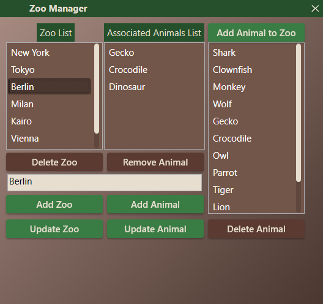

# WPF Zoo Manager (C# / MS SQL Server)

A custom-styled desktop CRUD application built with **WPF (.NET)** and **MS SQL Server** for managing zoos, animals, and their associations.

## Key Features

* **Complete CRUD Operations:** Create, Read, Update, and Delete records for both Zoos and Animals in real time.
* **Relational Database Integration:** Connects to Microsoft SQL Server via `Microsoft.Data.SqlClient`.
* **Many-to-Many Relationships:** Handles dynamic associations between Zoos and Animals using SQL `INNER JOIN` queries.
* **SQL Injection Protection:** Employs parameterized queries (`SqlCommand.Parameters`) across all database operations.
* **Input Validation & Safety:** Checks for duplicate entry records before inserting into the database.
* **Custom UI & Advanced XAML Styling:**
  * **Borderless Window:** Implemented a custom TitleBar supporting window dragging (`DragMove`) and custom close triggers.
  * **Control Templates & Triggers:** Custom-styled buttons with interactive hover/click animations (`TranslateTransform`) and drop shadows.
  * **Custom Scrollbars:** Fully redesigned WPF `ScrollBar` templates matching the application theme.
  * **Theming:** Defined resource dictionaries with custom Linear Gradients and Solid Brushes.

## Tech Stack

* **Language:** C# (.NET)
* **UI Framework:** WPF (Windows Presentation Foundation) / XAML
* **Database:** Microsoft SQL Server
* **Data Access:** ADO.NET / SqlClient, DataTables, DataAdapters
